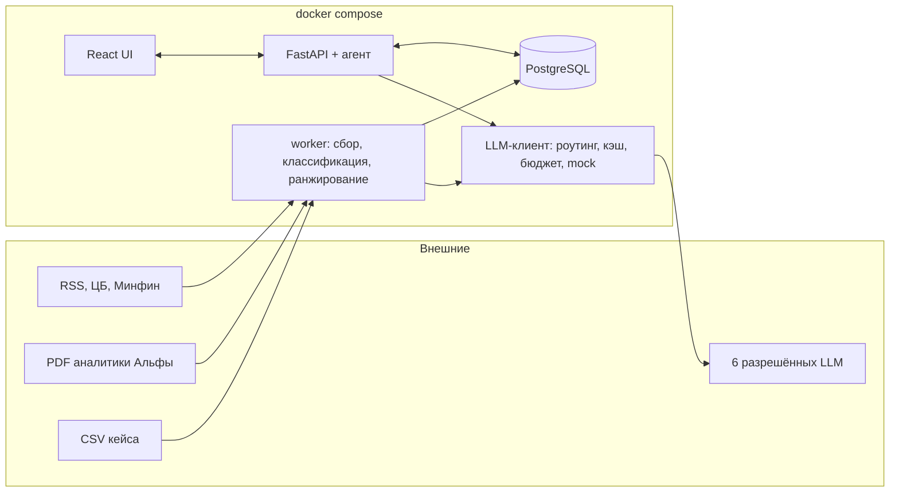
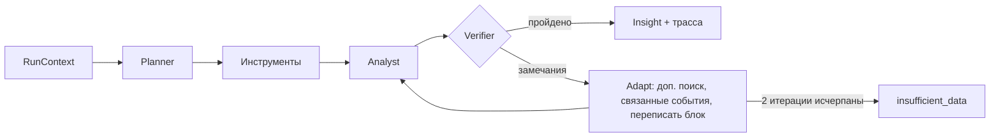

# Пульс бизнеса — персонализированная новостная аналитика для КИБ

Прототип команды «Эльбрус» для трека «Новостная аналитика для принятия бизнес-решений» (Альфа-Будущее Хакатон 2026).
Сервис встраивается в интернет-банк Альфа-Бизнеса: отбирает новости и аналитику Альфа-Банка под профиль конкретной
компании и роль руководителя, объясняет последствия и действия и связывает каждый вывод с первоисточником.

## Что умеет

| Требование кейса | Где реализовано |
| --- | --- |
| Контекст компании: отрасль, масштаб, место в отрасли, продукты, ВЭД, группа, контрагенты (задача 1, К-01) | `app/profile/`, правила `config/factors/*.yaml`, экран «Профиль компании» |
| Сбор и классификация новостей и аналитики банка (задача 2) | `app/ingest/`, `app/processing/` |
| Персональный отбор и ранжирование, разложение скора (задача 3) | `app/ranking/score.py` |
| Интерпретация на 6 вопросов: факт / банк / AI, риски, возможности, действия (задача 4, К-02, К-03) | `app/agent/analyst.py`, `config/interpretation.yaml` |
| Собственная агентная логика: план → инструменты → анализ → самопроверка → адаптация (с. 7, К-11) | `app/agent/` |
| Трассируемость выводов (К-12) | таблица `trace`, вкладка «Как получен вывод» |
| Интерфейс в стиле Альфа-Бизнеса, точка входа на главной, чат, разрезы, первоисточник (задача 5, К-09, К-10) | `ui/` |
| Новые новости, которых не было в демо (К-05) | экран «Проверить новость», `POST /api/v1/analyze` |
| Безопасность AI-компонентов (О-06) | `docs/security.md` |
| Метрики и мониторинг (К-08) | `app/eval.py`, `app/monitoring.py`, экран «Качество сервиса», `docs/monitoring.md` |
| Масштабирование (К-07) | новая отрасль, источник, роль — конфигом, см. «Как расширять» |

## Архитектура



Подробно: [docs/architecture.md](docs/architecture.md). Цикл агента:



## Требования к окружению

- Docker 24+ и Docker Compose v2 — для единого запуска;
- или локально: Python 3.12, [uv](https://docs.astral.sh/uv/) 0.5+, Node.js 20+;
- для `live`-режима — общий ключ организаторов (OpenAI-совместимый API).

## Запуск

### Docker (рекомендуется)

```bash
cp .env.example .env        # по умолчанию LLM_MODE=mock — работает без ключа
docker compose up --build   # http://localhost:8000
docker compose --profile worker up -d worker   # опционально: фоновый сбор каждые 30 минут
```

При первом старте база заполняется синтетическими данными и прогревается кэш инсайтов (около 20 секунд).

### Локально

```bash
make install   # uv sync + npm ci
make ui        # сборка интерфейса в ui/dist (его раздаёт FastAPI)
make seed      # загрузка данных, классификация, ранжирование, инсайты
make dev       # http://localhost:8000, Swagger: http://localhost:8000/docs
```

Без `DATABASE_URL` используется SQLite в `var/app.db`; в Docker — PostgreSQL.

### GitHub Codespaces

Откройте репозиторий в Codespaces: `.devcontainer` установит зависимости, соберёт UI и поднимет сервис на порту 8000.
Ключ к моделям задаётся секретами Codespaces `LLM_API_KEY` и `LLM_BASE_URL`.

### Сервер

CI собирает образ `ghcr.io/<owner>/<repo>:<sha>`. На сервере: `.env` с ключом, затем
`APP_IMAGE=ghcr.io/<owner>/<repo>:<sha> docker compose up -d` и HTTPS-прокси (nginx/Caddy) перед портом 8000.

## Переменные окружения

| Переменная | По умолчанию | Назначение |
| --- | --- | --- |
| `LLM_MODE` | `mock` | `live` — общий ключ; `mock` — детерминированный режим без вызовов моделей |
| `LLM_BASE_URL`, `LLM_API_KEY` | — | OpenAI-совместимый endpoint организаторов |
| `LLM_DAILY_BUDGET_RUB` | `500` | Дневной лимит; при 95% — только кэш и дешёвые шаги |
| `DATABASE_URL` | SQLite `var/app.db` | Например, `postgresql+psycopg://user:pass@db:5432/elbrus` |
| `DATA_DIR`, `ALFA_DIR`, `NEWS_DIR` | `data_synthetic/…` | Папки с CSV, отчётами Альфы и снимком новостей |
| `RSS_ENABLED` | `false` | Живой сбор из `config/sources.yaml` |
| `SESSION_SECRET` | dev-значение | Подпись токенов сессии |
| `HOST_LAUNCH_SECRET` | dev-значение | Общий с интернет-банком секрет подписи ссылок входа |
| `HOST_DEMO` | `true` | Демо-хост `/host-demo.html` и демо-подписант ссылок |
| `EMBED_ALLOWED_ORIGINS` | `'self'` | Какие сайты могут встраивать виджет (`frame-ancestors`) |
| `FEED_THRESHOLD`, `AGENT_TOP_N` | `0.35`, `5` | Порог ленты и число заранее готовых инсайтов на пользователя |
| `EMBEDDINGS` | `off` | Зарезервировано: поиск работает на BM25, эмбеддинги — после подтверждения организаторов |

ID моделей и тарифы — в `config/models.yaml`. **Перед live-запуском сверьте `api_id` и цены с данными организаторов**:
в репозитории стоят предполагаемые значения.

## Сценарий проверки

Тестовые учётки (пароль не нужен):

| Логин | Компания | Роль |
| --- | --- | --- |
| `cfo_a` | Металлургический комбинат «А»: экспорт в Китай, кредиты, группа из 4 компаний | Финансовый директор, администратор |
| `treasury_a`, `accountant_a` | та же компания | Казначей, главный бухгалтер |
| `ceo_b`, `cfo_b` | Продуктовая сеть «Б»: Москва, депозиты, 5000+ сотрудников | CEO, CFO |
| `cfo_c`, `owner_c` | Девелопер «В»: Екатеринбург, потенциальный клиент | CFO, собственник |

1. **Вход и точка входа.** Войдите как `cfo_a`. На главной справа — виджет «Пульс бизнеса» с тремя главными событиями.
2. **Персонализация.** «Открыть все события» — лента металлурга: пошлины, санкции, цены на сталь. Переключитесь на
   `ceo_b` (меню в правом верхнем углу): лента меняется на розницу — товарооборот, сахар, аренда. `accountant_a` видит
   ту же компанию с акцентом на налоги и регулирование.
3. **Интерпретация.** Откройте карточку. Шесть блоков; у каждого утверждения метка «Факт», «Альфа-Банк» или
   «Вывод AI» и ссылки на источник или признаки компании. Клик по источнику открывает текст с подсветкой цитаты.
4. **Трассировка.** Вкладка «Как получен вывод»: план, вызовы инструментов, модели, 7 проверок Verifier, признаки компании.
5. **Уточнение.** Чат: «Только риски», «Что говорит банк», «Как ставка влияет на наш долг?». Вопрос не по теме получает отказ.
6. **Новая новость.** «Проверить новость» → «Подставить пример» → «Проанализировать». Видно, как агент выполняет шаги.
   Нерелевантная новость (например, о спорте) получает статус «не значимо» с объяснением, а не выдуманную связь.
7. **Вход из интернет-банка.** Откройте `/host-demo.html` — имитацию главного экрана банка. Кнопка «Пульс бизнеса»
   в шапке со счётчиком, пункт меню и виджет справа. Клик по событию в виджете открывает карточку инсайта
   без экрана входа: банк выпускает подписанную одноразовую ссылку. Контракт — [docs/integration.md](docs/integration.md).
8. **Качество.** Под `cfo_a` раздел «Качество сервиса»: метрики, бюджет, офлайн-оценка, отрицательные отзывы.

API-проверка без UI — Swagger на `/docs`, спецификация в [docs/openapi.json](docs/openapi.json).

## Проверки

```bash
make lint   # ruff
make test   # 33 теста: профиль, классификация, ранжирование, агент, API, LLM-клиент, безопасность
make eval   # офлайн-метрики на eval/golden.csv → eval/results.json
```

Результаты на синтетическом наборе (mock-режим): precision@5 = 1.0 и nDCG@10 = 0.93 в среднем по трём компаниям,
различие лент компаний 0.75–0.89, все инсайты проходят 7 проверок Verifier, 100% инсайтов учитывают ≥ 2 фактора,
позиция банка есть в 75%. Разметку делал разработчик, поэтому цифры подтверждают работу пайплайна, но не заменяют
независимую разметку BA на реальных новостях.

## Данные

- `data_synthetic/` — синтетические CSV в формате кейса, 34 синтетические новости и 9 синтетических заменителей
  отчётов Альфы (названия из приложения 2, тексты написаны для демо и не являются позицией банка).
- Реальные данные кейса кладутся в `data/` (в Git не попадают), см. [data/README.md](data/README.md).
  Загрузчик определяет файлы по колонкам и терпит пропуски, «Да/Нет», разделители `;` и кодировку cp1251.

## Как расширять

- **Новая отрасль:** запись в `config/factors/industries.yaml` (префикс ОКВЭД → факторы с весами) и ключевые слова
  в `sector_keywords`.
- **Новый фактор:** `config/factors/catalog.yaml` (ключевые слова, направление) + шаблоны в `config/interpretation.yaml`.
- **Новый источник:** строка в `config/sources.yaml` (RSS) или класс-коннектор рядом с `app/ingest/news.py`.
- **Новая роль:** `config/roles.yaml` с множителями факторов.
- **Новая модель:** `config/models.yaml` и порядок в `routing`.

## Ограничения прототипа

- В mock-режиме классификация, планирование и тексты строятся правилами и шаблонами — это детерминированный
  запасной путь. В live-режиме те же шаги выполняют разрешённые модели, а правила остаются фолбэком.
- Разбор графиков в PDF через Qwen3-VL предусмотрен маршрутизацией (`vision`), но не включён: без реальных PDF его
  нечем проверить.
- Нет Alembic: схема создаётся `create_all`, миграции — следующий шаг.
- Rate limit хранится в памяти процесса.

## Компоненты

Backend: Python 3.12, FastAPI, SQLAlchemy 2, Pydantic 2, PostgreSQL / SQLite, собственный BM25, Snowball-стемминг,
APScheduler. Frontend: React 18, Vite, TypeScript, CSS без UI-фреймворков. Полный перечень с лицензиями —
[THIRD_PARTY_NOTICES.md](THIRD_PARTY_NOTICES.md).

## Версия к дедлайну

Тег `v1.0-final` и полный хеш коммита указываются здесь в момент сдачи: `<commit hash>`.
Для приватного репозитория доступ выдаётся аккаунту `alfa-hack-2026`.
